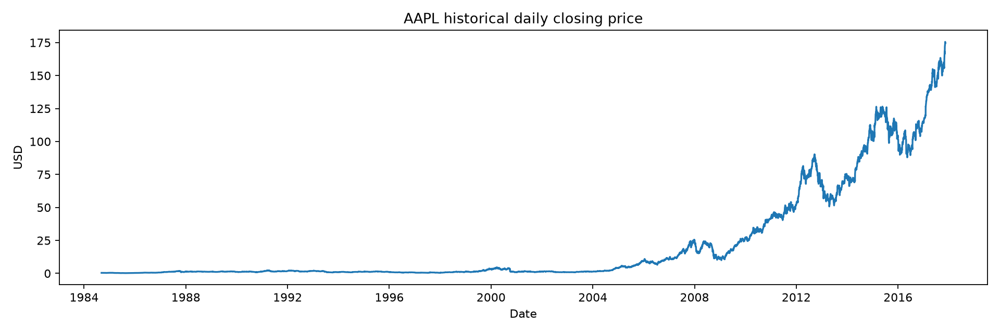
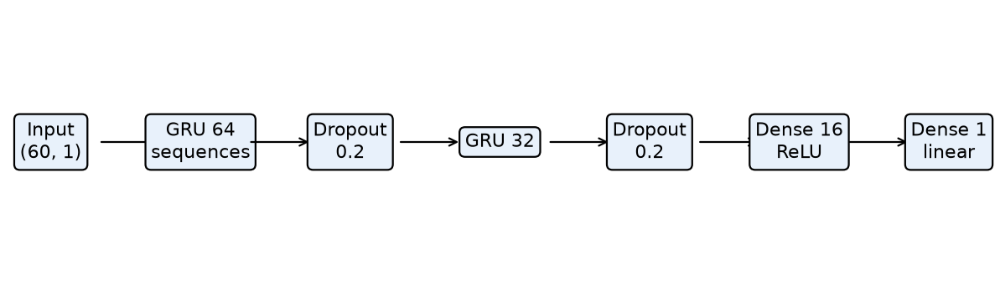
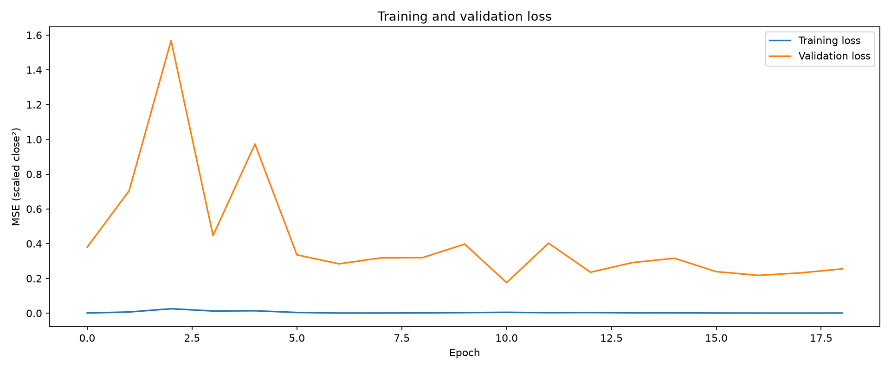
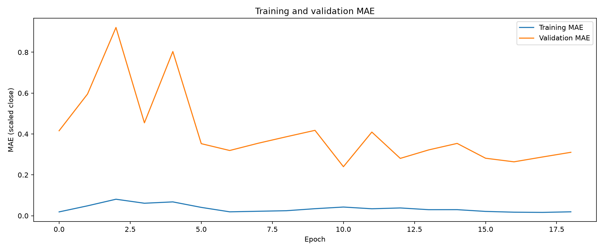
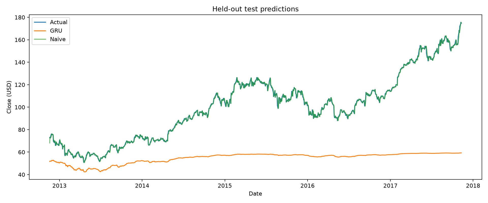
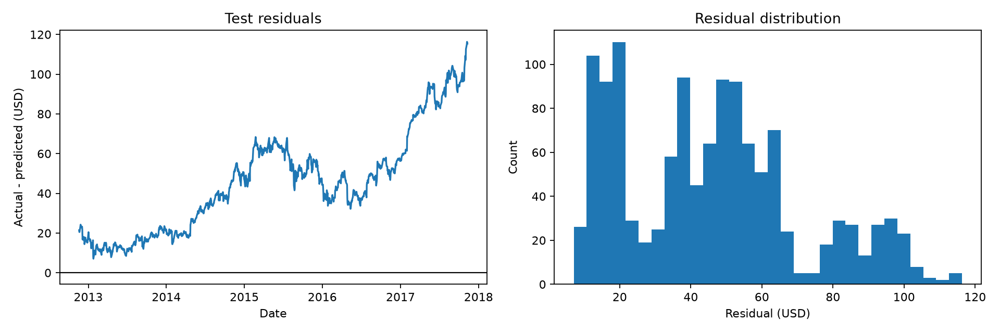

# StockVision AI — Stock Price Forecasting Using GRU

**Student:** Ritik Raj · **Registration Number:** 23FE10ITE00256  
**University:** Manipal University Jaipur · **Course:** Deep Learning  
**Case Study:** 7 — Stock Price / Time-Series Forecasting

## Abstract

This project forecasts the next trading day's AAPL closing price from the preceding 60 closing prices using a gated recurrent unit (GRU). The actual run used chronological train/validation/test partitions, training-only MinMax scaling, validation early stopping, and a naive persistence baseline. Persistence substantially outperformed the GRU on the held-out test period.

## 1. Problem Statement

Given historical Apple (AAPL) closing prices, estimate the Close on the next trading day. Only observations available before that date may enter the model input. Forecasting stock prices is challenging because the series is noisy and nonstationary. A GRU is evaluated as the assigned recurrent architecture, and naive persistence is the required reference baseline.

## 2. Dataset Description

The selected data file is `dataset/AAPL.csv`, copied byte-for-byte from `D:/Stocks/aapl.us.txt`, the historical US stocks archive provided in the workspace. The data follows the professor-recommended Kaggle historical stock dataset format. It has columns Date, Open, High, Low, Close, Volume, and OpenInt, with 8,364 observations from 1984-09-07 to 2017-11-10. The CSV was readable; required values had no missing entries and dates had no duplicates. The model uses only Close to meet the required one-feature input. This historical series ends in 2017 and cannot represent current market conditions. Attribution: Boris Marjanovic, [Price, Volume Data for All US Stocks & ETFs](https://www.kaggle.com/datasets/borismarjanovic/price-volume-data-for-all-us-stocks-etfs), Kaggle.

## 3. Data Preprocessing

Dates are parsed, invalid required rows removed, chronological order enforced, duplicate dates removed, and Close converted to numeric. The 60-observation lookback predicts the immediately following trading day's Close. For target row *t*, inputs are rows *t-60* through *t-1*; row *t* is not included. The MinMaxScaler is fit only on the first 70% of chronological rows and then applied to validation and test data without refitting. Target dates are split chronologically into 70% training, 15% validation and 15% testing (5,854/1,255/1,255 rows); the training sequence count is 5,794 after initial lookback context. Assertions check shapes, finite values, ordering, non-overlap of target partitions, and alignment. No random split is used.

## 4. Model Architecture

A GRU processes a sequence using gates. The **update gate** controls how much previous hidden state is retained in the next state. The **reset gate** controls how much past state informs the candidate state. These gates help manage information flow through time; they do not guarantee extrapolation of future price levels.

**Input (60, 1) → GRU(64, return_sequences=True) → Dropout(0.2) → GRU(32) → Dropout(0.2) → Dense(16, ReLU) → Dense(1, linear).**

| Layer | Output shape | Trainable parameters |
|---|---:|---:|
| Input | (None, 60, 1) | 0 |
| GRU (64, sequences) | (None, 60, 64) | 12,864 |
| Dropout (0.2) | (None, 60, 64) | 0 |
| GRU (32) | (None, 32) | 9,408 |
| Dropout (0.2) | (None, 32) | 0 |
| Dense (16, ReLU) | (None, 16) | 528 |
| Dense (1, linear) | (None, 1) | 17 |
| **Total** |  | **22,817** |

## 5. Experimental Setup

The run used Python 3.12.13 and TensorFlow/Keras 2.21.0 on native Windows CPU; native Windows GPU execution was unavailable. The notebook is Jupyter/Google Colab compatible and has a Colab file-upload fallback. The optimizer is Adam with learning rate 0.001; loss is MSE and the tracked metric is MAE. Batch size is 32, maximum epochs 50, random seed 42, and training shuffling is disabled. Early stopping monitors validation loss with patience 8 and restores the best weights. Training stopped after 19 epochs.

The restored best-validation model has training MAE **$0.8964** and validation MAE **$5.8366** after inverse scaling. Per-epoch training/validation loss and MAE are shown below (loss and MAE curves use scaled units).

## 6. Results and Discussion

The held-out test target dates are 2012-11-19 through 2017-11-10. Metrics are computed after inverse scaling, on identical target dates for both models; MAPE is expressed as a percentage.

| Model | MAE (USD) | RMSE (USD) | MSE (USD^2) | MAPE |
|---|---:|---:|---:|---:|
| Naive persistence | 1.0417 | 1.4845 | 2.2038 | 1.0813% |
| GRU | 45.5624 | 52.1620 | 2720.8778 | 41.7290% |

Persistence clearly outperforms the GRU. The chronological split places training through roughly 2007 and later validation/test prices extend far beyond the training-only MinMax range. This univariate price-level network does not extrapolate that changing scale. The result is reported as measured; the test set was not used to tune the model. Price prediction error is not trading profitability.

## Conclusion

The specified GRU was trained and evaluated without time-series shuffling or scaler leakage. It did not beat naive persistence on the later AAPL test dates. This is a valid negative result and a practical demonstration that a model trained on historical absolute prices may not extrapolate across market regimes.

## Limitations

Close-only inputs omit volume, OHLC range, company fundamentals, news, macroeconomic events and corporate actions. One holdout period cannot guarantee performance in other periods. Absolute prices are nonstationary; results do not include transaction costs, slippage or risk and do not establish a profitable trading method. The available archive ends in 2017. No license file or Git metadata accompanied the original project checkout, so its original license terms could not be checked.

## References and attribution

1. Boris Marjanovic, [Price, Volume Data for All US Stocks & ETFs](https://www.kaggle.com/datasets/borismarjanovic/price-volume-data-for-all-us-stocks-etfs), Kaggle.
2. Cho et al. (2014), “Learning Phrase Representations using RNN Encoder–Decoder for Statistical Machine Translation,” arXiv:1406.1078.
3. [TensorFlow Keras GRU documentation](https://www.tensorflow.org/api_docs/python/tf/keras/layers/GRU).
4. Adapted from [ax5hay/Stock-Market-Prediction-GRU](https://github.com/ax5hay/Stock-Market-Prediction-GRU). Original notebooks are retained; no LICENSE file was provided in the workspace.
